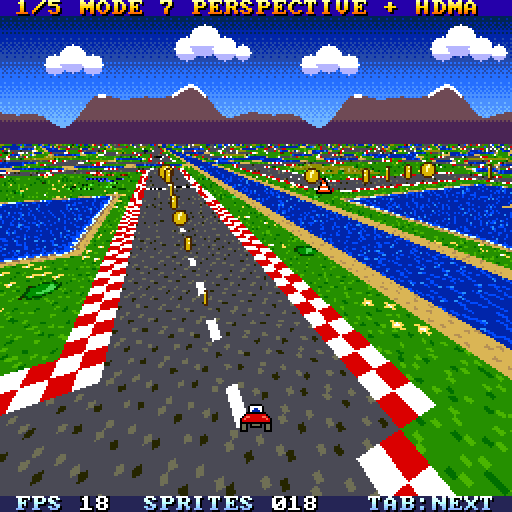
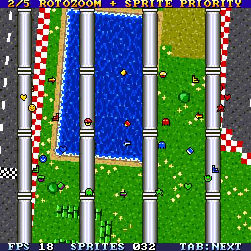
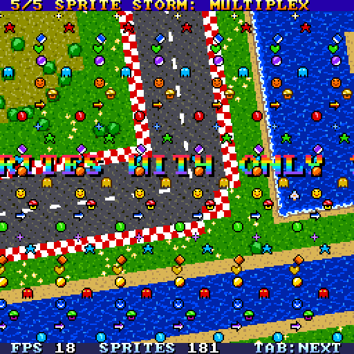

# PPU

A small PPU (picture processing unit, the chip that draws the screen in old consoles) written in Verilog and simulated with Verilator.

I made it to replicate for fun a GBA like ppu (so with affine BG rendering and multiple background layers).

| | |
|---|---|
|  |  |
| Mode 7: the background matrix changes on every line | Rotation and zoom, with sprites passing behind the foreground |
|  |  |
| Three views on one screen, each with its own matrix | 181 sprites, rewriting the 32 OAM entries during the frame |

## About the use of AI

The Verilog is the point of this project: the PPU in `verilog/` was made for study.

The simulation is not. Writing SDL windows, demos and an editor was never the goal, I just needed a way to see what the PPU was drawing. So the C++ code in `verilator/` was made with the help of AI.

If you are here to look at something, look at the Verilog.

## What it does

- 256x256 picture inside a 640x480 VGA signal, RGB332 colors converted to RGB888 for simplicity
- two tile layers, background and foreground, each with its own 64x64 map, 256 tiles and scroll
- an affine matrix per layer, for rotation, zoom and shear; rewriting it on every line gives a Mode 7 floor
- 8x8 tiles at 4 bits per pixel, 16 palettes, horizontal and vertical flip
- 32 sprites, 8x8, with flip and a low priority bit to go behind the foreground
- up to 8 sprites per line

There are also two unused bits in the tile attributes and a "big sprite" bit in the OAM that does nothing for now.

## Writing to the PPU

Everything goes through the ports of `ppu.v`, one write per clock. The memories have a separate read port, so they can be written at any time, even while the picture is drawn. The simulation uses only these: it keeps a copy of the VRAM and sends what changed.

### VRAM bus

`we_vram`, `vram_addr_in` (16 bits), `vram_din` (8 bits). The top two bits pick the area:

| Address | Bits | What |
|---|---|---|
| `0000`-`1FFF` | `00 0` + 13 | BG tiles: 256 tiles x 32 bytes |
| `2000`-`2FFF` | `00 10` + 12 | BG map: 64x64 cells, one tile number each |
| `3000`-`3FFF` | `00 11` + 12 | BG attributes: one byte per cell |
| `4000`-`7FFF` | `01` ... | FG, same layout as the BG |
| `8000`-`80FF` | `10 00` + 12 | BG palettes: 16 banks x 16 colors, RGB332 |
| `9000`-`90FF` | `10 01` + 12 | FG palettes |
| `A000`-`A0FF` | `10 10` + 12 | sprite palettes |
| `C000`-`C7FF` | `11` + 14 | sprite tiles: 64 tiles x 32 bytes |

The palette and sprite tile memories are smaller than their area, so they mirror inside it (`8100` writes the same byte as `8000`). `B000`-`BFFF` is free.

- **Tiles:** 8x8 pixels at 4 bits, 4 bytes per row, the low nibble is the left pixel. Color 0 is transparent on the FG and on the sprites.
- **Attributes:** bit 0 flips X, bit 1 flips Y, bits 3:2 are free, bits 7:4 pick the palette bank.

### OAM bus

`we_oam`, `oam_addr_in` (5 bits, the sprite), `oam_din` (32 bits, a whole sprite in one write):

| Bits | What |
|---|---|
| 8:0 | X, screen x + 8 (0..7 clips the sprite on the left) |
| 17:9 | Y, screen y |
| 23:18 | tile |
| 27:24 | palette bank |
| 28, 29 | flip X, flip Y |
| 30 | low priority: behind the FG |
| 31 | big sprite, not used yet |

Sprite 0 is drawn on top. The OAM can be rewritten during the frame: the sprites of a line are read at the end of the line before.

### Layer registers

Each layer has its own ports, all 16.16 fixed point: `scroll_x`, `scroll_y` and the matrix `m00`, `m01`, `m10`, `m11`. A pulse on `we_scroll` loads all six at once. Pixel (x, y) of the screen reads the map at

```
map_x = scroll_x + m00 * x + m10 * y
map_y = scroll_y + m01 * x + m11 * y
```

Writing them during the hblank changes the next line: that is how the Mode 7 floor and the split screen work.

## The code

| File | What it is |
|---|---|
| `ppu.v` | top module, connects everything |
| `vga.v` | VGA counters and sync |
| `bg_layer.v`, `bg_layer_top.v` | a tile layer and its memories |
| `sprite_layer.v`, `sprite_layer_top.v` | sprite scan and its memories |
| `sprite_shifter.v` | shifts out the pixels of one sprite |
| `color_mixer.v` | priority, transparency and palettes |
| `ram.v`, `pipe.v` | small helpers |

`tb/` has a testbench for the sprite layer.

## Running it

You need Verilator, a C++ compiler, make, pkg-config and SDL2.

```sh
make            # builds everything
make simple     # or just one program
```

Every program ends up in its own folder:

```sh
./obj_simple/Vppu                 # one scene, sprites you can move
./obj_layer/Vppu                  # two layers, transparency, rotating background
./obj_tech_demo/Vppu              # five scenes, press I for the inspector
./obj_editor/Vppu my_level.ppus   # draw your own scene
```

The inspector shows what each layer is doing, the registers of every line and the OAM:


The editor, with a small sample scene:


The full list of keys is in the comment at the top of each `.cpp` file (`simple` prints it in the terminal).
