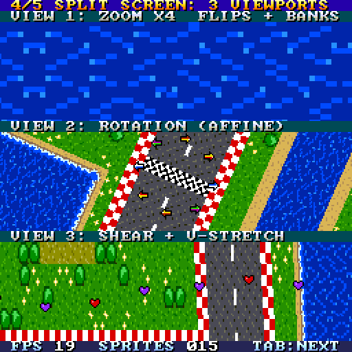
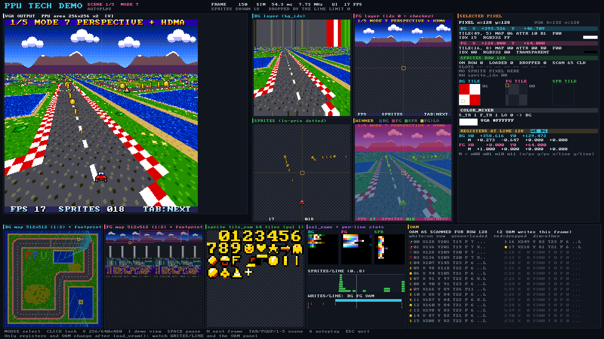
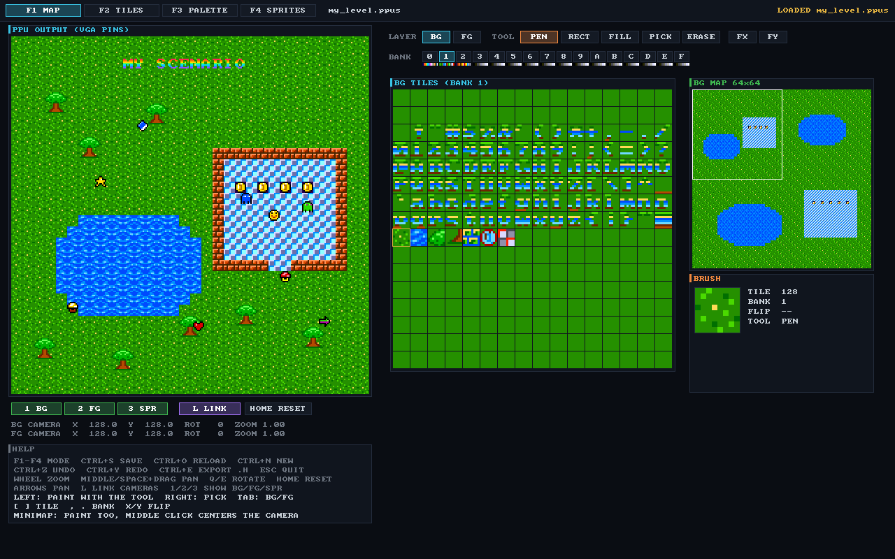

# PPU

A small PPU (picture processing unit, the chip that draws the screen in old consoles) written in Verilog and simulated with Verilator.

I made it to replicate for fun a GBA like ppu (so with affine BG rendering and multiple background layers).

| | |
|---|---|
|  |  |
| Mode 7: the background matrix changes on every line | Rotation and zoom, with sprites passing behind the foreground |
|  |  |
| Three views on one screen, each with its own matrix | 181 sprites, rewriting the 32 OAM entries during the frame |

## About the use of AI

The Verilog is the point of this project: the PPU in `verilog/` was made for study.

The simulation is not. Writing SDL windows, demos and an editor was never the goal, I just needed a way to see what the PPU was drawing. So the C++ code in `verilator/` was made with the help of AI.

If you are here to look at something, look at the Verilog.

## What it does

- 256x256 picture inside a 640x480 VGA signal, RGB332 colors converted to RGB888 for simplicity
- two tile layers, background and foreground, each with its own 64x64 map, 256 tiles and scroll
- an affine matrix per layer, for rotation, zoom and shear; rewriting it on every line gives a Mode 7 floor
- 8x8 tiles at 4 bits per pixel, 16 palettes, horizontal and vertical flip
- 32 sprites, 8x8, with flip and a low priority bit to go behind the foreground
- up to 8 sprites per line

The memories have no write port connected yet: the simulation writes tiles, maps and palettes straight into them. There are also two unused bits in the tile attributes and a "big sprite" bit in the OAM that does nothing for now.

## The code

| File | What it is |
|---|---|
| `ppu.v` | top module, connects everything |
| `vga.v` | VGA counters and sync |
| `bg_layer.v`, `bg_layer_top.v` | a tile layer and its memories |
| `sprite_layer.v`, `sprite_layer_top.v` | sprite scan and its memories |
| `sprite_shifter.v` | shifts out the pixels of one sprite |
| `color_mixer.v` | priority, transparency and palettes |
| `ram.v`, `pipe.v` | small helpers |

`tb/` has a testbench for the sprite layer.

## Running it

You need Verilator, a C++ compiler, make, pkg-config and SDL2.

```sh
make            # builds everything
make simple     # or just one program
```

Every program ends up in its own folder:

```sh
./obj_simple/Vppu                 # one scene, sprites you can move
./obj_layer/Vppu                  # two layers, transparency, rotating background
./obj_tech_demo/Vppu              # five scenes, press I for the inspector
./obj_editor/Vppu my_level.ppus   # draw your own scene
```

The inspector shows what each layer is doing, the registers of every line and the OAM:



The editor, with a small sample scene:



The full list of keys is in the comment at the top of each `.cpp` file (`simple` prints it in the terminal).
